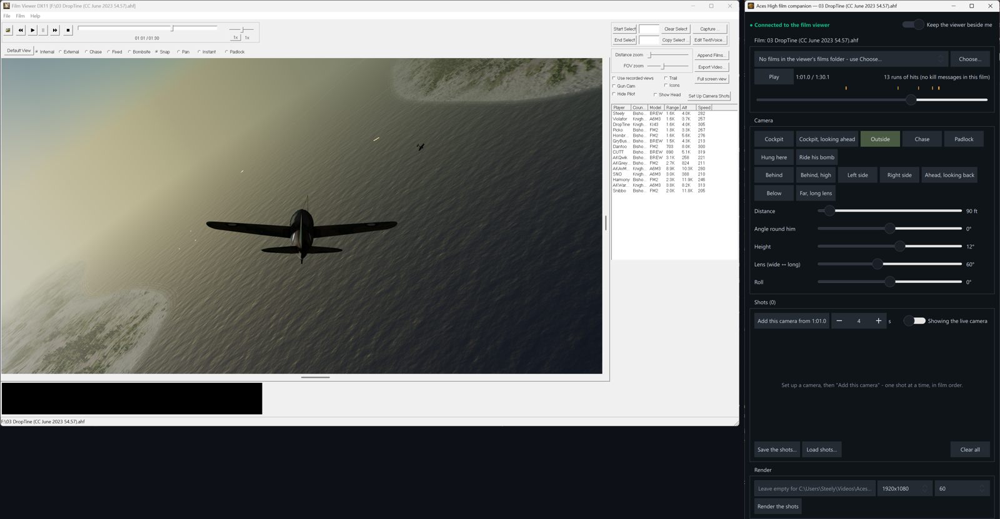
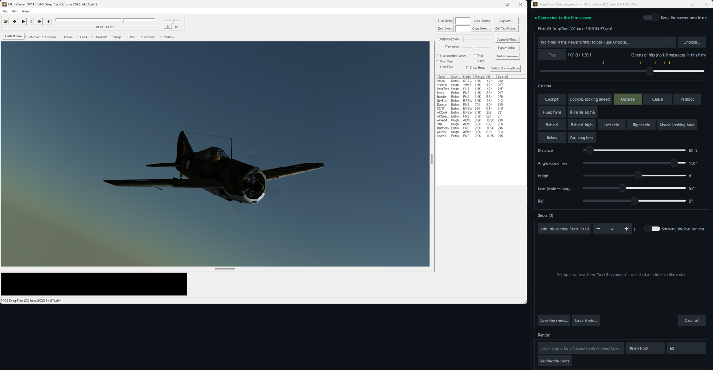
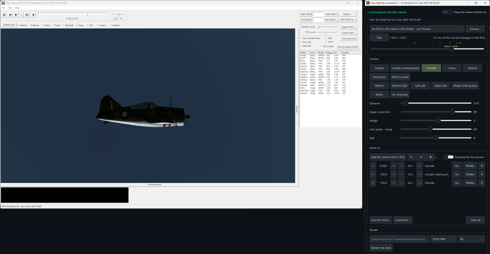

# Aces High film companion

Camera controls for the **Aces High film viewer**, for pilots who make films by hand - no AI needed. Open one of
your films, put cameras anywhere round your aircraft with sliders that move the picture live, line up your shots and
render the video with the film's sound.

It drives the viewer through its socket only - the same published commands an AI assistant uses - and adds nothing
to the game or the viewer.

## Download

1. Download the zip from **[Releases](../../releases/latest)** (`aces-high-film-companion-<version>-win64.zip`).
2. Unzip it anywhere (e.g. your Desktop). There's nothing to install.
3. Run `film_companion.exe`.

You need Windows and Aces High with the new film viewer, the one with **Help > Socket Instructions for AI** in its
menu.

## How to use it

**1. Connect and open a film.** The companion finds the film viewer in the usual install folders (or press
**Browse…** and pick `ahfilm.exe` in your `Aces High III\ah32` folder), then press **Start it**. When the top line
turns green, press **Choose…** and open one of your films. The viewer parks itself beside the companion. Your kills,
hits and landings are marked along the timeline: drag the slider to the moment you want.

**2. Pick a camera and move it.** Press a camera - **Cockpit**, **Outside**, **Chase**, **Padlock** (keeps a bandit
in frame), **Hung here** (a camera left in the sky), **Ride his bomb** - or one of the ready angles (**Behind**,
**Left side**, **Ahead, looking back**...). Then fine-tune it with the sliders: distance, angle round him, height,
lens and roll. The viewer's picture follows as you drag.

**3. Add your shots.** When the picture looks right, press **Add this camera** - it adds a shot from that moment for
the number of seconds beside it. Move along the film and add the next. Shots show as bars on the timeline; nudge
their start and length, **Go** to look at one again, **Retake** it with the current camera, or delete it. **Save
the shots…** keeps the list to carry on later. Click one of your kills on the timeline for a whole kill sequence in
one go.

**4. Render.** Pick the size and frame rate and press **Render the shots**. The viewer records each shot with the
film's sound into one MP4 (in your Videos folder unless you choose another).

**[The manual](docs/MANUAL.md)** covers every control.

## Build

Qt 6.5+ (Core, Gui, Network, Qml, Quick) and CMake:

    cmake -S . -B build -DCMAKE_PREFIX_PATH=<Qt>/msvc2022_64
    cmake --build build --config Release

`tools/package.sh` makes the release zip. **Keeping the docs current:** every change to a control, kind, slider or
behaviour updates docs/MANUAL.md (and its pictures, made with `--grab` / `tools/manual_shots.py`) in the same
commit; the README's pictures come from `tools/readme_shots.py`.
