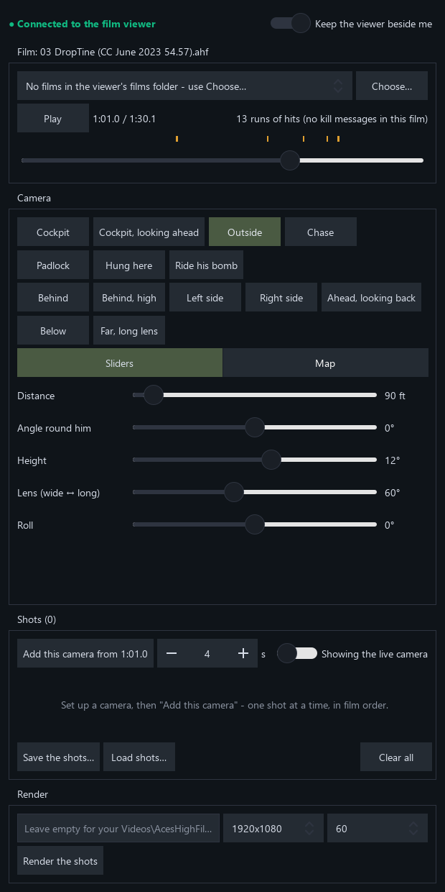
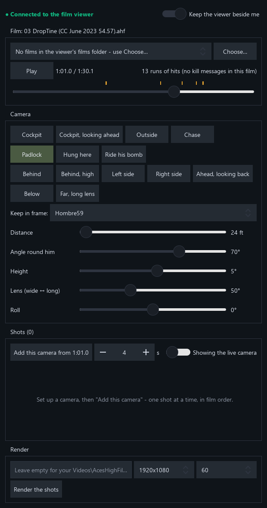
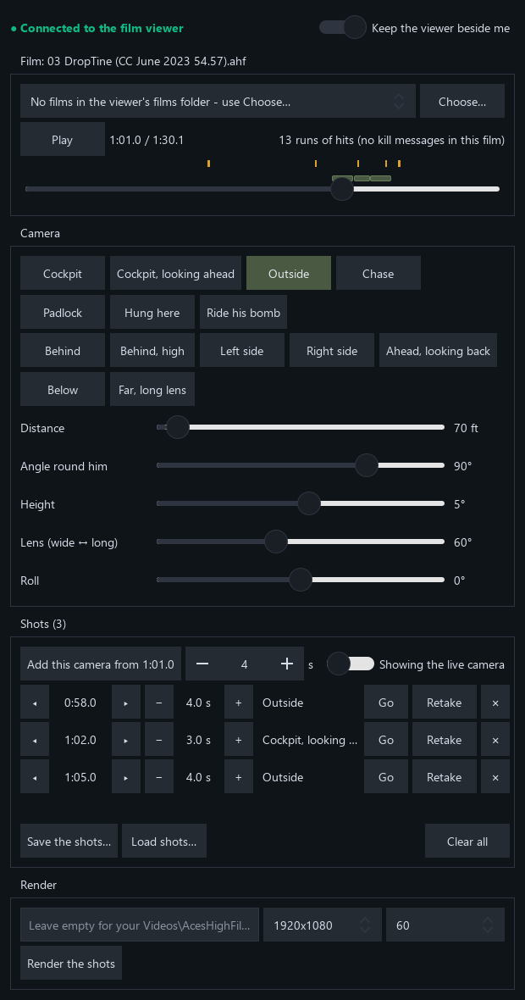

# Aces High film companion - manual

The companion is a set of camera controls for the Aces High film viewer. Open one of your films, put cameras
anywhere round your aircraft, line up the shots you want, and render the video - by hand, no AI needed. It talks to
the film viewer only through the viewer's own socket (the same commands an AI assistant uses), so it changes nothing
in the game or the viewer.

## What you need

- Aces High with the film viewer that has the AI socket (Help > Socket Instructions for AI in its menu).
- Windows. The companion's folder runs as it is; there's nothing to install.

## Starting

1. Run `film_companion.exe`.
2. If the film viewer isn't running, the top line says so (amber). The first time, the companion looks for the viewer
   in the usual places Aces High is installed and fills in where it is. If it can't find it, press **Browse…** and pick
   `ahfilmai.exe` (or `ahfilm.exe`) in your `Aces High III\ah32` folder. Press **Start it**. It remembers it for next
   time.
3. When the top line turns green - **Connected to the film viewer** - you're ready.

**Keep the viewer beside me** (top right, on by default) parks the viewer's window against the companion's left
edge, at a 16:9 size, and keeps it there when you move or resize the companion. The two stay together in front of
other windows and minimise together. Turn it off to place the viewer yourself.

## The film

- **Choose…** opens a film from anywhere. The list beside it shows the films in the viewer's own films folder.
  Your films are never changed: the viewer only plays them.
- **Play / Pause**, and the time: where you are and how long the film is.
- **The timeline.** Drag the bar to move through the film: while you drag it jumps quickly, and where you let go it
  settles on the exact moment. The marks above it:
  - **red** - your kills (grey: other pilots' kill messages the film holds);
  - **amber** - your hits on another aircraft;
  - **green** - your bombs, rockets and torpedoes being dropped (where to start **Ride his bomb**);
  - **blue** - landings.

  Point at a mark to see what it is. Click one of **your kills or hits** for a choice: **Go to a few seconds before**,
  or **Add a kill sequence (3 shots)** (see Shots). Click any other mark to jump to a few seconds before. Your shots
  show as **olive bars** just under the marks: click one to go to it. Some films (squad nights, events)
  have no kill messages; then your hits show where the fights were, and the count says so.

## The camera

What the viewer shows while you set up a shot is the **live camera**. Pick a kind, a place, then fine-tune with the
sliders: the viewer's picture follows as you move them.

**Kinds**

| Button | What it shows |
|---|---|
| Cockpit | Your view as you flew it (if you were in an outside or gunner's view, that's what shows). |
| Cockpit, looking ahead | Your cockpit from the pilot's eye, looking straight ahead, whatever view you were in. |
| Outside | A camera riding along with your aircraft, placed round it by the sliders, always looking at it. |
| Chase | The viewer's chase camera at that place - trailing you smoothly. |
| Padlock | The outside camera turned to keep another aircraft in frame - pick who in **Keep in frame**. From the wing in a low fight it looks like WW2 gun-camera film. |
| Hung here | Leaves a camera standing in the sky where the outside camera is now, turning to watch you fly past. |
| Ride his bomb | Rides your next bomb, rocket or torpedo from release to impact, then holds on the blast. Set it just before the drop. |

**Places** put the camera at a starting point round you: Behind, Behind high, Left side, Right side, Ahead looking
back, Below, and Far with a long lens.

**Sliders**

| Slider | What it does |
|---|---|
| Distance | How far the camera is from your aircraft (feet). |
| Angle round him | Round you: 0 behind, 90 your right, 180 ahead, -90 your left. |
| Height | Above you (positive) or below (negative), in degrees. |
| Lens (wide ↔ long) | Wide shows more around you; long zooms in. A long lens from far away compresses a chase. |
| Roll | Tilts the picture - a little roll makes level flight look more dynamic. |

## Shots

A film is a list of shots, each a camera from one moment to the next.

1. Move to where the shot should start (the timeline, or a mark).
2. Set up the camera.
3. Set how long it lasts (seconds) and press **Add this camera from …**.
4. Move on and do the next one.

**A kill sequence in one click:** click one of your kills (red) on the timeline and choose **Add a kill sequence**. It
lays the shots a kill usually wants: an outside camera behind you as you close in, your cockpit as you flew it for the
shooting, a
padlock from your wing on the victim as he goes down, then an outside camera on you flying away. On a run of hits
(amber) it lays the first three. Then change any of them as you like - nudge, lengthen, Retake or delete.

Each shot in the list has:

| Control | What it does |
|---|---|
| ◂ ▸ | Start the shot half a second earlier or later. |
| − + | Make it half a second shorter or longer. |
| Go | Jump to the shot's start. |
| Retake | Give the shot the camera you have set up now - set up something better, then press it. |
| ✕ | Delete the shot. |

The switch beside **Add** flips between **Showing the live camera** (what you're setting up) and **Playing the shots**
(press Play to watch your cut). Between and after your shots the viewer shows the cockpit as you flew it.

**Save the shots…** keeps the list in a file (`.shots.json`) to come back to later or share; **Load shots…** brings one
back; **Clear all** empties the list.

## Render

1. Pick the size (720p, 1080p or 4K) and frame rate (30 or 60).
2. Type where the video should go, or leave it empty: it goes in `Videos\AcesHighFilms`, named after the film and
   the time. The path can't contain spaces (the viewer's rule).
3. **Render the shots.** The viewer makes the `.mp4` with the film's sound, from your first shot to the end of your
   last. It takes a little longer than the clip plays; the button counts the time while it works.

## Things to know

- **Other aircraft move in small steps** in a film, the far ones more so: cameras look best placed round your own
  aircraft. A padlock frames others from your aircraft, which works well.
- **Just after a respawn** the ground near you can draw wrong for a few seconds. Start shots a few seconds later.
- If the viewer asks you something (a terrain to download, for example), the top of the companion says so - answer it
  in the viewer's window.
